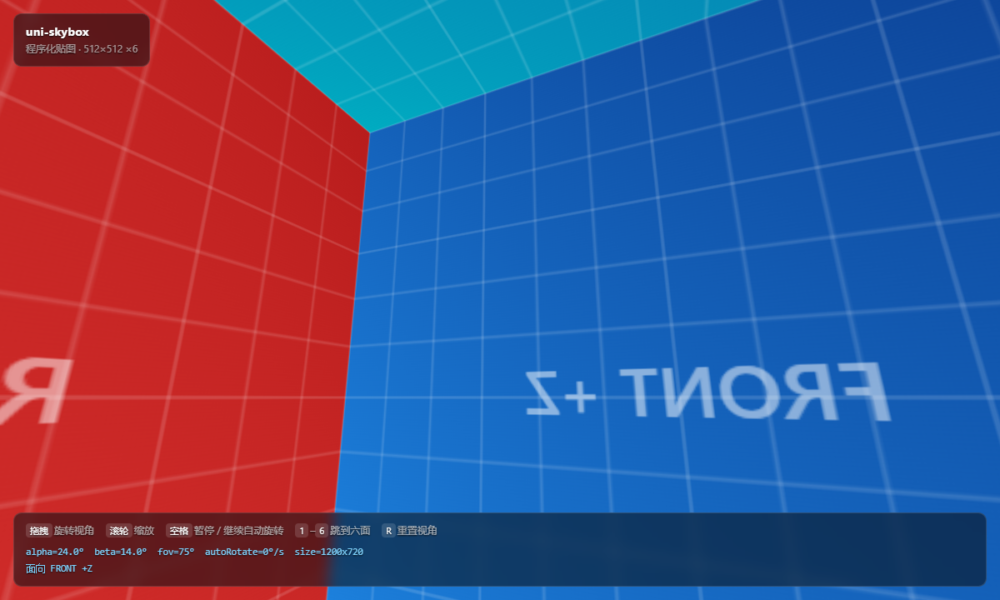

# uni-skybox

[](https://github.com/zhouzheng123456/uni-skybox/actions/workflows/ci.yml)
[](./LICENSE)

一个**独立天空盒渲染库**：零运行时依赖、TypeScript 编写、产物同时提供 ESM 与 UMD，
可直接运行在 **uni-app (Vue2 / Vue3) 的 H5 与微信小程序**中（也适用于任何 WebGL1 环境）。

约 950 行 TypeScript（含注释），只做一件事：把一个六面立方体贴图渲染成可自由环视的天空背景。



---

## 特性

- **六面立方体贴图**：贴图源可以是 URL、`HTMLImageElement`、`HTMLCanvasElement` 或小程序 `canvas.createImage()` 的结果
- **拖拽环视**：内置 `DragControl`，H5 一行 `bindDOM()` 接入鼠标/触摸，小程序用 `start/move/end` 转发坐标
- **自动旋转**：`autoRotate`（度/秒），运行时修改立即生效
- **视角控制**：`alpha`（偏航）/ `beta`（俯仰）/ `fov`（缩放）
- **无全局单例**：不需要任何引擎或场景容器，同一页面可创建、销毁多个实例，路由切换不会互相污染
- **自动适配宿主环境**：`requestAnimationFrame`、`devicePixelRatio`、图片创建方式内部自动选择
- **WebGL1**：兼容性最好，`CLAMP_TO_EDGE + LINEAR` 下支持非 2 次幂贴图，不强制 mipmap

## 设计取舍

- **36 顶点、无索引**：立方体直接展开成 36 个顶点，`drawArrays` 一次画完，不需要索引缓冲与几何体中间层
- **天空盒永远以相机为中心**：绘制前剔除视图矩阵的平移分量，不依赖"盒子足够大"这类技巧
- **实例化而非单例**：每个 `SkyboxViewer` 自己持有 WebGL 资源并提供 `destroy()`，同页多实例、路由切换都安全
- **按需查询 uniform**：program 封装不做全量反射，只查用得到的 attribute / uniform
- **范围之外**：拾取、阴影、灯光、材质、模型加载、正交相机等，按需自行扩展

## 安装

```bash
npm install uni-skybox
```

本地开发 / 不想发版时，用 `file:` 依赖指向本地目录，先把产物构建出来：

```bash
git clone https://github.com/zhouzheng123456/uni-skybox.git
cd uni-skybox && npm install && npm run build
```

```json
{
  "dependencies": {
    "uni-skybox": "file:../uni-skybox"
  }
}
```

## 快速开始（普通 H5）

```html
<canvas id="skybox" style="width: 100vw; height: 100vh; display: block"></canvas>
<script src="node_modules/uni-skybox/dist/uni-skybox.umd.js"></script>
<script>
  const { SkyboxViewer, DragControl } = UniSkybox;

  const canvas = document.getElementById('skybox');

  const viewer = new SkyboxViewer({
    canvas,
    autoRotate: 6,       // 度/秒
    fov: 75,
  });

  // 也可以把已加载好的图片对象直接传给 images
  viewer.setImageUrls({
    front: '/sky/front.jpg',
    back: '/sky/back.jpg',
    left: '/sky/left.jpg',
    right: '/sky/right.jpg',
    top: '/sky/top.jpg',
    bottom: '/sky/bottom.jpg',
  }).then(() => {
    viewer.resize(canvas.clientWidth, canvas.clientHeight);
    viewer.start();
  });

  new DragControl(viewer).bindDOM(canvas);
</script>
```

ESM / 打包环境：

```js
import { SkyboxViewer, DragControl } from 'uni-skybox';
```

## 在 uni-app (Vue2) 中使用

### 一个可直接照抄的组件

```vue
<template>
  <view class="skybox-wrap">
    <!-- #ifdef MP-WEIXIN -->
    <canvas
      id="skybox-canvas"
      type="webgl"
      canvas-id="skybox-canvas"
      class="skybox-canvas"
      disable-scroll
      @touchstart="onTouchStart"
      @touchmove="onTouchMove"
      @touchend="onTouchEnd"
      @touchcancel="onTouchEnd"
    ></canvas>
    <!-- #endif -->

    <!-- #ifdef H5 -->
    <view id="skybox-h5" ref="h5Wrap" class="skybox-canvas"></view>
    <!-- #endif -->
  </view>
</template>

<script>
import { SkyboxViewer, DragControl } from 'uni-skybox';

const IMAGES = {
  front: 'https://cdn.example.com/sky/front.jpg',
  back: 'https://cdn.example.com/sky/back.jpg',
  left: 'https://cdn.example.com/sky/left.jpg',
  right: 'https://cdn.example.com/sky/right.jpg',
  top: 'https://cdn.example.com/sky/top.jpg',
  bottom: 'https://cdn.example.com/sky/bottom.jpg',
};

export default {
  data() {
    return {
      viewer: null,
      control: null,
    };
  },

  mounted() {
    this.init();
  },

  // 页面隐藏时停掉渲染循环，省电
  onHide() {
    this.viewer && this.viewer.stop();
  },

  onShow() {
    this.viewer && this.viewer.start();
  },

  beforeDestroy() {
    this.destroy();
  },

  methods: {
    async init() {
      const target = await this.getCanvas();
      if (!target) {
        return;
      }

      const { canvas, width, height, dpr } = target;

      try {
        this.viewer = new SkyboxViewer({
          canvas,
          fov: 75,
          autoRotate: 6,
        });

        await this.viewer.setImageUrls(IMAGES);

        this.viewer.resize(width, height, dpr);
        this.viewer.start();

        this.control = new DragControl(this.viewer, { sensitivity: 0.2 });

        // #ifdef H5
        // H5 下 canvas 是裸 DOM 节点，事件可以直接绑
        this.control.bindDOM(canvas);
        // #endif
      } catch (error) {
        console.error('[skybox] 初始化失败', error);
        this.destroy();
      }
    },

    getCanvas() {
      // #ifdef MP-WEIXIN
      return new Promise((resolve) => {
        uni.createSelectorQuery()
          .in(this)
          .select('#skybox-canvas')
          .fields({ node: true, size: true })
          .exec((res) => {
            const item = res && res[0];
            if (!item || !item.node) {
              resolve(null);
              return;
            }
            resolve({
              canvas: item.node,
              width: item.width,
              height: item.height,
              dpr: uni.getSystemInfoSync().pixelRatio,
            });
          });
      });
      // #endif

      // #ifdef H5
      return new Promise((resolve) => {
        this.$nextTick(() => {
          const wrap = this.$refs.h5Wrap;
          const element = wrap && (wrap.$el || wrap);
          if (!element) {
            resolve(null);
            return;
          }

          // 自己造一个裸 canvas，避免 uni 的 canvas 组件占用 2D 上下文
          const canvas = document.createElement('canvas');
          canvas.style.width = '100%';
          canvas.style.height = '100%';
          canvas.style.display = 'block';
          canvas.style.touchAction = 'none';
          element.appendChild(canvas);

          const rect = element.getBoundingClientRect();

          resolve({
            canvas,
            width: rect.width,
            height: rect.height,
            dpr: window.devicePixelRatio || 1,
          });
        });
      });
      // #endif
    },

    onTouchStart(e) {
      const p = this.point(e);
      this.control && p && this.control.start(p.x, p.y);
    },

    onTouchMove(e) {
      const p = this.point(e);
      this.control && p && this.control.move(p.x, p.y);
    },

    onTouchEnd() {
      this.control && this.control.end();
    },

    // 小程序给的是相对 canvas 的 x/y，H5 给的是 clientX/clientY
    point(e) {
      const touch = e.touches && e.touches[0];
      if (!touch) {
        return null;
      }
      return {
        x: touch.x === undefined ? touch.clientX : touch.x,
        y: touch.y === undefined ? touch.clientY : touch.y,
      };
    },

    destroy() {
      if (this.control) {
        this.control.destroy();
        this.control = null;
      }
      if (this.viewer) {
        this.viewer.destroy();
        this.viewer = null;
      }
    },
  },
};
</script>

<style>
.skybox-wrap {
  width: 100%;
  height: 100vh;
}

.skybox-canvas {
  display: block;
  width: 100%;
  height: 100%;
}
</style>
```

### 为什么 H5 要自己创建 canvas

uni-app 的 `<canvas>` 在 H5 下会被编译成 uni 自己的 canvas 组件，内部已经占用了 2D 上下文，
直接在其中调用 `getContext('webgl')` 会失败或互相干扰。所以 H5 分支用一个 `<view>` 容器，
手动 `document.createElement('canvas')` 追加进去，最稳。

微信小程序则相反：必须用 `<canvas type="webgl">`，并通过 `createSelectorQuery().fields({ node: true })`
拿到真实节点，`uni.createCanvasContext` 拿到的 2D 上下文对 WebGL 无效。

## 在 uni-app (Vue3) 中使用

库本身与框架无关（纯 TypeScript 类，不碰 `this`、不依赖生命周期），Vue3 下用法完全一样，
只需把示例组件从选项式 API 改成组合式 API。差异一共只有这几处：

| 位置 | Vue2 | Vue3 |
| --- | --- | --- |
| 生命周期 | `mounted` / `beforeDestroy` | `onMounted` / `onBeforeUnmount` |
| 页面钩子 | 组件里直接写 `onShow()` / `onHide()` | 从 `@dcloudio/uni-app` 导入 `onShow` / `onHide` |
| 模板 ref | `this.$refs.h5Wrap` | `const h5Wrap = shallowRef(null)` + `ref="h5Wrap"` |
| 选择器作用域 | `createSelectorQuery().in(this)` | `.in(getCurrentInstance().proxy)`，`<script setup>` 里没有 `this` |
| 下一个 tick | `this.$nextTick` | `nextTick`（从 `vue` 导入） |
| 保存 viewer / control | `data()` | 普通变量，不放 `ref` / `reactive` |

完整组件（可直接照抄）：

```vue
<template>
  <view class="skybox-wrap">
    <!-- #ifdef MP-WEIXIN -->
    <canvas
      id="skybox-canvas"
      type="webgl"
      canvas-id="skybox-canvas"
      class="skybox-canvas"
      disable-scroll
      @touchstart="onTouchStart"
      @touchmove="onTouchMove"
      @touchend="onTouchEnd"
      @touchcancel="onTouchEnd"
    ></canvas>
    <!-- #endif -->

    <!-- #ifdef H5 -->
    <view ref="h5Wrap" class="skybox-canvas"></view>
    <!-- #endif -->
  </view>
</template>

<script setup>
import { getCurrentInstance, nextTick, onBeforeUnmount, onMounted, shallowRef } from 'vue';
import { onHide, onShow } from '@dcloudio/uni-app';
import { SkyboxViewer, DragControl } from 'uni-skybox';

const IMAGES = {
  front: 'https://cdn.example.com/sky/front.jpg',
  back: 'https://cdn.example.com/sky/back.jpg',
  left: 'https://cdn.example.com/sky/left.jpg',
  right: 'https://cdn.example.com/sky/right.jpg',
  top: 'https://cdn.example.com/sky/top.jpg',
  bottom: 'https://cdn.example.com/sky/bottom.jpg',
};

const { proxy } = getCurrentInstance();
const h5Wrap = shallowRef(null);

// viewer / control 用普通变量保存，避免被 Vue 的响应式代理包一层
let viewer = null;
let control = null;

onMounted(init);
onBeforeUnmount(destroy);

// 页面隐藏时停掉渲染循环，省电
onHide(() => viewer && viewer.stop());
onShow(() => viewer && viewer.start());

async function init() {
  const target = await getCanvas();
  if (!target) {
    return;
  }

  const { canvas, width, height, dpr } = target;

  try {
    viewer = new SkyboxViewer({
      canvas,
      fov: 75,
      autoRotate: 6,
    });

    await viewer.setImageUrls(IMAGES);

    viewer.resize(width, height, dpr);
    viewer.start();

    control = new DragControl(viewer, { sensitivity: 0.2 });

    // #ifdef H5
    // H5 下 canvas 是裸 DOM 节点，事件可以直接绑
    control.bindDOM(canvas);
    // #endif
  } catch (error) {
    console.error('[skybox] 初始化失败', error);
    destroy();
  }
}

function getCanvas() {
  // #ifdef MP-WEIXIN
  return new Promise((resolve) => {
    uni
      .createSelectorQuery()
      .in(proxy) // Vue3 必须显式传组件实例
      .select('#skybox-canvas')
      .fields({ node: true, size: true })
      .exec((res) => {
        const item = res && res[0];
        if (!item || !item.node) {
          resolve(null);
          return;
        }
        resolve({
          canvas: item.node,
          width: item.width,
          height: item.height,
          dpr: uni.getSystemInfoSync().pixelRatio,
        });
      });
  });
  // #endif

  // #ifdef H5
  return new Promise((resolve) => {
    nextTick(() => {
      const wrap = h5Wrap.value;
      const element = wrap && (wrap.$el || wrap);
      if (!element) {
        resolve(null);
        return;
      }

      // 自己造一个裸 canvas，避免 uni 的 canvas 组件占用 2D 上下文
      const canvas = document.createElement('canvas');
      canvas.style.width = '100%';
      canvas.style.height = '100%';
      canvas.style.display = 'block';
      canvas.style.touchAction = 'none';
      element.appendChild(canvas);

      const rect = element.getBoundingClientRect();

      resolve({
        canvas,
        width: rect.width,
        height: rect.height,
        dpr: window.devicePixelRatio || 1,
      });
    });
  });
  // #endif
}

function onTouchStart(e) {
  const p = point(e);
  control && p && control.start(p.x, p.y);
}

function onTouchMove(e) {
  const p = point(e);
  control && p && control.move(p.x, p.y);
}

function onTouchEnd() {
  control && control.end();
}

// 小程序给的是相对 canvas 的 x/y，H5 给的是 clientX/clientY
function point(e) {
  const touch = e.touches && e.touches[0];
  if (!touch) {
    return null;
  }
  return {
    x: touch.x === undefined ? touch.clientX : touch.x,
    y: touch.y === undefined ? touch.clientY : touch.y,
  };
}

function destroy() {
  if (control) {
    control.destroy();
    control = null;
  }
  if (viewer) {
    viewer.destroy();
    viewer = null;
  }
}
</script>

<style>
.skybox-wrap {
  width: 100%;
  height: 100vh;
}

.skybox-canvas {
  display: block;
  width: 100%;
  height: 100%;
}
</style>
```

两个容易踩的点：

1. **不要把 viewer 装进 `ref` / `reactive`**。响应式会深代理整个对象，WebGL 上下文、`Float32Array`、canvas 节点被 Proxy
   包一层后，部分小程序环境会出现类型判断失败或性能骤降。用普通变量，或者 `shallowRef` + `markRaw(viewer)`。
2. **`#ifdef` 在 `<script setup>` 里是否生效取决于 HBuilderX 版本**。若发现 H5 也去执行小程序分支（报
   `document` / `uni.createSelectorQuery` 相关错误），把 `<script setup>` 换成 `export default { setup() { ... } }`
   即可，库的调用方式完全不变。

## API

### `new SkyboxViewer(options)`

| 参数 | 类型 | 默认值 | 说明 |
| --- | --- | --- | --- |
| `canvas` | `HTMLCanvasElement \| 小程序 canvas 节点` | 必填 | 目标画布 |
| `images` | `CubeImages` | - | 已加载完成的六面贴图 |
| `fov` | `number` | `75` | 垂直视角（度） |
| `alpha` | `number` | `0` | 偏航角（度），`0` 正对 `front` 面 |
| `beta` | `number` | `0` | 俯仰角（度），限制在 `[-89.9, 89.9]` |
| `autoRotate` | `number` | `0` | 自动旋转速度（度/秒） |
| `clearColor` | `[r, g, b, a]` | `[0,0,0,1]` | 清屏颜色，0~1 浮点 |
| `contextAttributes` | `object` | - | 透传 `canvas.getContext('webgl', attrs)` |

实例成员：

| 成员 | 说明 |
| --- | --- |
| `static create(options, urls?)` | 创建实例（可选一步加载贴图），返回 `Promise<SkyboxViewer>` |
| `setImages(images)` | 传入已加载的六面贴图 |
| `setImageUrls(urls)` | 传入六面贴图地址，返回 `Promise<void>` |
| `setView(alpha, beta)` | 直接设置视角（度） |
| `rotateBy(dx, dy)` | 按像素增量旋转，供手势控制调用 |
| `setFov(fov)` | 设置垂直视角，内部限制在 `[20, 110]` |
| `resize(width, height, dpr?)` | 按 CSS 像素设置尺寸，内部自动乘以 dpr |
| `render()` | 手动渲染一帧 |
| `start()` / `stop()` | 启动 / 停止渲染循环 |
| `isRunning()` | 是否在渲染循环中 |
| `destroy()` | 释放 program / buffer / texture 并停止循环 |
| `camera` | `SkyCamera`，可直接改 `alpha` / `beta` / `fov` |
| `gl` / `canvas` | 暴露原生上下文，便于二次开发 |

### `new DragControl(viewer, options)`

| 方法 | 说明 |
| --- | --- |
| `start(x, y)` / `move(x, y)` / `end()` | 由宿主转发坐标，小程序走这条路径 |
| `zoom(delta)` | 缩放 fov，`delta > 0` 拉远 |
| `bindDOM(element)` | 仅 H5：绑定鼠标、滚轮、触摸事件 |
| `destroy()` | 解绑所有事件 |

`options`：`sensitivity`（默认 `0.2` 度/像素）、`minFov`（默认 `20`）、`maxFov`（默认 `100`）。

### 工具函数

```js
import {
  loadCubeImages,       // (urls, canvas?) => Promise<CubeImages>
  loadImage,            // (url, canvas?) => Promise<Image>
  createImage,          // (canvas) => Image，浏览器/小程序自适应
  getDevicePixelRatio,  // () => number
  isMiniProgramCanvas,  // (canvas) => boolean
  CUBE_FACES,           // ['front', 'back', 'left', 'right', 'top', 'bottom']
} from 'uni-skybox';
```

## 朝向约定

| 面 | 方向 | 对应 `alpha`（正对该面） |
| --- | --- | --- |
| `front` | +Z | `0` |
| `right` | +X | `90` |
| `back` | -Z | `180` |
| `left` | -X | `270` |
| `top` | +Y | `beta = 90` |
| `bottom` | -Y | `beta = -90` |

`alpha` 增大 → 视角向 +X 方向偏航；`beta` 为正 → 抬头。

> 立方体贴图按 WebGL 规范存储（`+Z` 面是"从盒外看"的样子），因此在盒内环视时，
> 直接用图片查看器打开 `front.jpg` 看到的内容会是**左右镜像**的，属正常现象。
> 由全景图转换得到的标准六面图（three.js / Photoshop 等工具产出）显示是正确的。

## 已知限制

- 只支持 **WebGL1**，微信小程序需基础库 ≥ 2.7.0，且 iOS 上 canvas 必须处于可见区域才会渲染
- 六面贴图必须是**正方形且尺寸一致**（立方体贴图的硬性要求），尺寸不一致会抛出明确错误
- 小程序里用网络图片作为 `canvas.createImage()` 的 `src`，需要把域名加入 **downloadFile 合法域名**
- 浏览器跨域图片需要服务端返回 CORS 头，否则 `texImage2D` 会因安全限制失败
- 贴图建议 ≤ 2048，六张 2048 的 RGBA 贴图在低端机上已接近显存上限

## 开发

```bash
npm install
npm run build      # tsc 产出 ESM + d.ts，rollup 合并出 ESM / UMD 单文件
npm run typecheck  # 只做类型检查
npm run verify     # 构建并跑数学自检（相机朝向、绕序、拖拽符号）
npm run demo       # 启动本地静态服务，打开 http://localhost:5173/demo/
```

demo **不附带任何第三方贴图**：它会先尝试加载 `demo/assets/` 下的
`front` / `back` / `left` / `right` / `top` / `bottom` 六张同名图片（`.png`，可选 `.webp`），
找不到时自动回退到现场用 canvas 画出的六张带网格与标签的程序化贴图——所以克隆下来就能离线跑，
想用真实天空盒时把自己的图放进 `demo/assets/` 即可（六张同尺寸正方形）。

> 程序化贴图上的面名从盒子内部看是左右镜像的，这是立方体贴图“按从盒外看的方向存储”导致的，属正常现象。

调试参数（追加在 `demo/` 地址后）：

| 参数 | 说明 |
| --- | --- |
| `alpha` / `beta` | 初始水平朝向 / 俯仰角，单位：度 |
| `fov` | 初始垂直视角，默认 75 |
| `auto` | 自动旋转速度（度/秒），`0` 表示不转 |
| `fmt` | 贴图格式，默认 `png`，可选 `webp` |
| `face` | 直接跳到某一面：`front` / `back` / `left` / `right` / `top` / `bottom` |

例如 `http://localhost:5173/demo/?face=top&auto=0` 会直接看向顶面并停止自动旋转。

目录结构：

```
src/
├─ skybox-viewer.ts      # 对外主类：生命周期、渲染循环、resize
├─ camera/sky-camera.ts  # 球坐标相机
├─ core/
│  ├─ skybox-renderer.ts # 绘制流程
│  ├─ cube-geometry.ts   # 36 顶点立方体
│  ├─ cube-texture.ts    # 立方体贴图上传
│  └─ gl-program.ts      # program/uniform 封装
├─ controls/drag-control.ts
├─ image/loader.ts
├─ platform.ts           # 浏览器 / 小程序差异
├─ math/mat4.ts
├─ shaders/index.ts
└─ types.ts
```

## 贡献

欢迎 issue 与 PR。提交前请确认本地检查全绿：

```bash
npm install
npm run verify   # 类型检查 + 构建 + 数学自检
```

- 改动相机、矩阵或几何相关代码时，请同步在 `scripts/verify-math.mjs` 里补充对应自检项
- `dist/` 与 `node_modules/` 由构建产生，不随提交进入仓库
- 提交信息建议遵循 [Conventional Commits](https://www.conventionalcommits.org/zh-hans/)
- 使用的第三方贴图必须是可再分发的（CC0 / 自有），并在 PR 中说明来源

## 许可

[MIT](./LICENSE) © 2026 [zhouzheng123456](https://github.com/zhouzheng123456)

可自由使用、修改、商用与再分发，只需保留版权声明与许可声明。